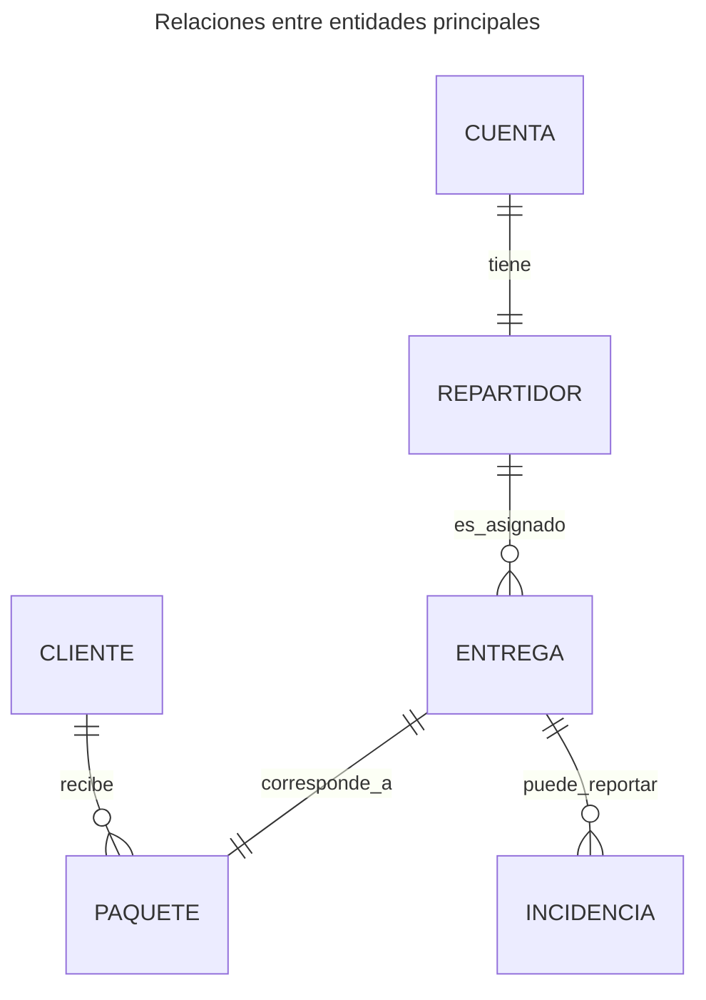
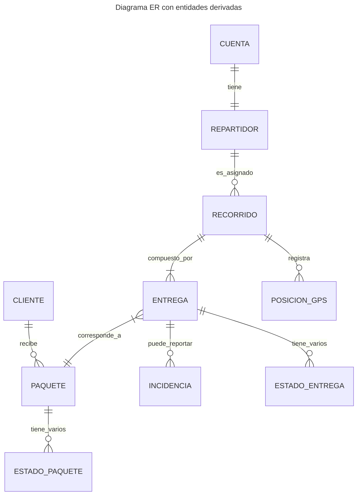
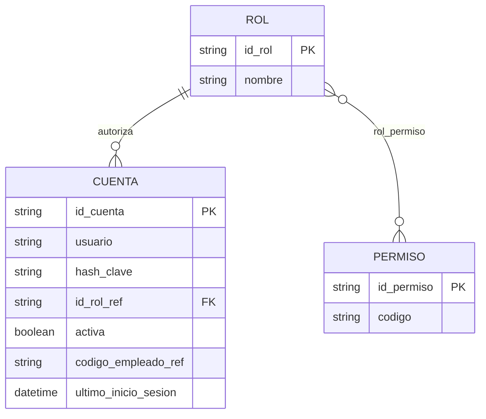
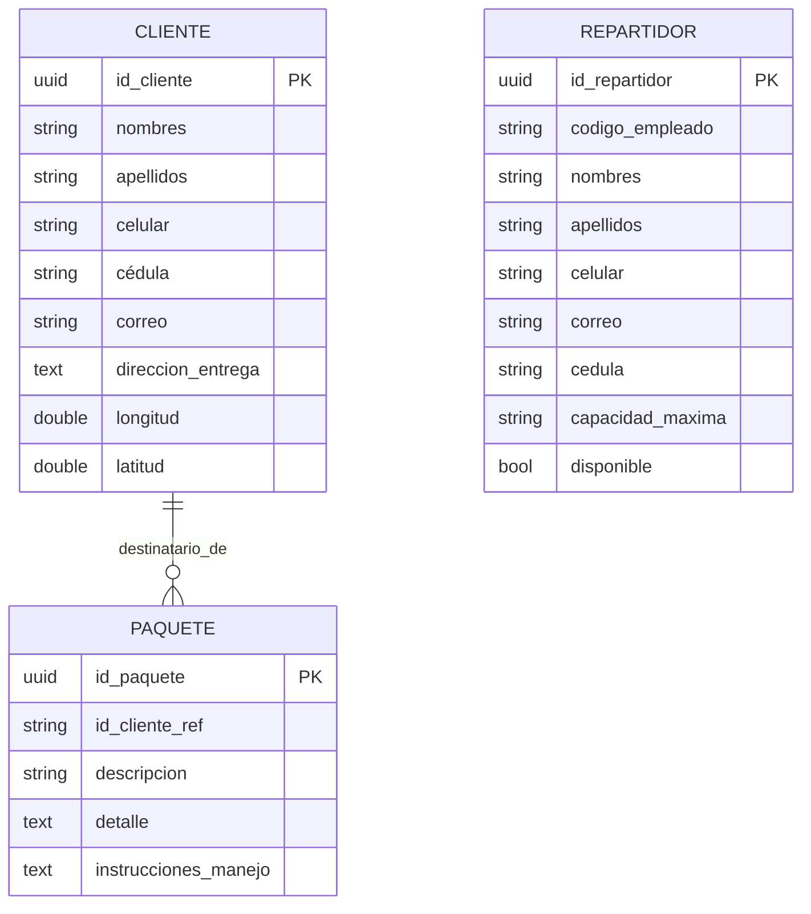
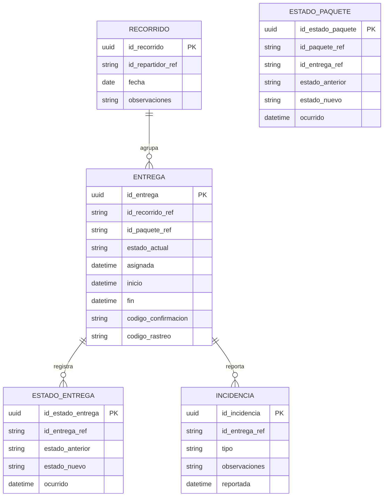
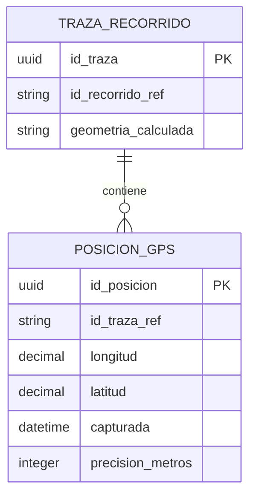

# Modelado de Datos - Sistema Trackfast
En este documento se definen las entidades, relaciones y tipos de datos con los que trabajará el backend del sistema "Trackfast".

> [!NOTE]
> En este archivo no se detallan los modelos entidad-relación para datos esctructurados, ni los modelos para datos no estructurados.

---
1. [Entidades principales](#1-entidades-principales)
2. [Relaciones y entidades derivadas](#2-relaciones-y-entidades-derivadas)
3. [Desglose de las entidades en datos.](#3-desglose-de-entidades-en-datos)
4. [Asignación de las entidades a los módulos.](#4-asignación-de-las-entidades-a-los-módulos)
---

## 1. Entidades Principales
En base a las historias de usuario y a los casos de uso, se pueden definir las siguientes entidades principales dentro del sistema.

| **Entidad**| **Rol**|
|:--:|-|
| *Cliente*| Esta entidad almacena los datos del cliente, incluida su información de contacto en caso de ser necesario, su ubicación que se usará para realizar las entregas. |
|*Repartidor*| Esta entidad almacena los datos de los repartidores de la empresa, debe incluir su información personal, e información sobre si está disponible en ese momento, cuál es el máximo de entregas que puede tener asignadas y un identificador dentro de la empresa.|
|*Paquete*| Esta entidad almacena información sobre el paquete depositado para un cliente, debe contener una descripción del paquete, junto con indicaciones especiales si es necesario, y debe permitir monitorear su estado. Además debe contar con un código único de paquete para generar el QR de confirmación de la entrega, y para permitir monitorear su estado si está en camino.|
|*Entrega*|Esta entidad almacena la información de la entrega en progreso de un paquete al cliente, por medio del repartidor. Debe indicar en qué momento inicia y acaba, permitir monitorear los cambios de estado e incidencias durante el recorrido, y contar con un código de verificación generado para la confirmación.|
|*Incidencia*|Esta entidad almacena la información del reporte de una incidencia o problema ocurrida durante la entrega que pueda retrasar su llegada, con el fin de informar al cliente y al administrador.|
|*Cuenta*|Esta entidad almacena información para autenticar y autorizar el acceso de los usuarios al sistema. Esta entidad debe almacenar las credenciales de cada usuario, su código de empleado, su rol (Administrador o Repartidor), e indicar si la cuenta sigue activa.|
|*Posición GPS*| Esta entidad almacena la información de la ubicación del repartidor en un momento dado durante la entrega, por lo que recolecta su latitud, longitud y momento de captura del dato para poder ordernar las posiciones y reconstruir su recorrido.|

## 2. Relaciones y entidades derivadas
### 2.1. Relaciones
Partiendo de las entidades definidas a nivel general, se pueden observar las siguientes relaciones:

* Todo repartidor debe tener **una única** cuenta
* A un repartidor se le asignan **varias o ningúna** entrega.
* Una entrega es asignada a **un solo** repartidor.
* Una entrega corresponde a **un solo** paquete.
* Durante una entrega se pueden reportar **varias o ninguna** incidencias.

### 2.2. Entidades Derivadas
En base a un análisis más detallado de los requisitos del sistema, se definieron las siguientes entidades derivadas de las entidades principales:

| **Entidad Derivada**|**Deriva de**|**Rol**|
|:-:|-|-|
| *EstadoEntrega*| **Entrega**| Esta entidad almacena la información sobre los cambios de estado de una entrega, es decir la fecha de transición, el estado original y el nuevo estado. De acuerdo con la historia de usuario **HU5**, existen 4 estados para una entrega: <ins>En progreso, cancelada,atrasada y completada</ins>. |
| *EstadoPaquete*| **Paquete**| Esta entidad almacena la información sobre los cambios de estado de un paquete, es decir la fecha de transición, el estado original y el nuevo estad. De acuerdo con las historias de usuario, existen 5 estados para un paquete: <ins>Almacenado(En bodega), en distribución, perdido, dañado o entregado</ins>|
|*Recorrido*|**Envío**|Esta entidad representa la lista diaria de entregas que maneja un repartidor. Almacena la información sobre la fecha, el orden de entregas, el total de entregas de ese recorrido, el total de entregas completado. Esta entidad recolecta los datos del GPS, para mejorar la trazabilidad al reconstruir el recorrido de cada día en lugar de por entrega, y permite manejar casos de entregas sin completar.|

Con estas entidades, el diagrama ER actualizado es el siguiente:
las siguientes relaciones:

#### Entidades Descartadas
| **Entidad Derivada**|**Deriva de**|**Motivo de Descarte**|
|:--:|-|-|
| *Notificación*| **Incidencia**|La notificación comparte la misma información reportada en la incidencia, por lo que no es necesario guardar un registro de notificaciones. Entonces puede manejar como un evento y un objeto volátil en el sistema.|

## 3. Desglose de entidades en datos

### 3.1. Datos estructurados (Almacenables en BDD SQL)
#### Cuenta
| **Atributo** | **Tipo** | **Descripción** | **Obligatorio (No nulo)** |
|:-:|:-:|-|:-:|
|*usuario*|*String*|Nombre de usuario de la cuenta|X|
|*clave*|*String*|Contraseña para acceder a la cuenta. Dato protegido y hasheado|X|
|*correo*|*String*|Correo vinculado a la cuenta, para fines de recuperación o información.|X|
|*rol*|*String*|Rol del usuario: Administrador o Repartidor|X|
|*ultimo_inicio_sesion*|*Timestamp*| Fecha y hora del último ingreso a la cuenta para fines de seguridad.|X|
|*activo*|*Booleano*|Indica si la cuenta aún está habilitada|X|

#### Repartidor
| **Atributo** | **Tipo** | **Descripción** | **Obligatorio (No nulo)** |
|:-:|:-:|-|:-:|
|*cédula*|*String*|Documento de identificación del repartidor|X|
|*nombres*|*String*|Nombres completos del repartidor|X|
|*apellidos*|*String*|Apellidos completos del repartidor|X|
|*correo*|*String*|Correo de contacto del repartidor|X|
|*celular*|*String*|Número de teléfono del repartidor|X|
|*cod_empleado*|*Entero*|Indentificador del repartidor dentro de la empresa, vincula con la cuenta|X|
|*max_entregas*|*Entero*|Cantidad máxima de entregas que puede realizar un repartidor por día.|X|
|*disponible*|*Booleano*| Indica si el repartidor está trabajando al momento y está dispoinible para recibir entregas.|X|

#### Cliente
| **Atributo** | **Tipo** | **Descripción** | **Obligatorio (No nulo)** |
|:-:|:-:|-|:-:|
|*cédula*|*String*|Documento de identificación del repartidor|X|
|*nombres*|*String*|Nombres completos del repartidor|X|
|*apellidos*|*String*|Apellidos completos del repartidor|X|
|*correo*|*String*|Correo de contacto del repartidor|X|
|*celular*|*String*|Número de teléfono del repartidor|X|
|*direccion*|*Texto*|Calles y referencia de ubicación para encontrar la ubicación proporcionada por el cliente para recibir paquetes..|X|
|*dir_latitud*|*Decimal*|Latitud de la ubicación proporcionada por el cliente.|X|
|*dir_longitud*|*Decimal*|Longitud de la ubicación proporcionada por el cliente.|X|

#### Paquete
| **Atributo** | **Tipo** | **Descripción** | **Obligatorio (No nulo)** |
|:-:|:-:|-|:-:|
|*cod_cliente*|*String*|Atributo que vincula con el cliente a quien se envía el paquete|X|
|*descripcion_breve*|*String*|Descripción breve del contenido|X|
|*descripcion_completa*|*Texto*|Descripción detallada del contenido|X|
|*estado*|*String(enum)*|Estado del paquete [Almacenado(En bodega), en distribución, perdido, dañado o entregado]|X|
|*instrucc_adicionales*|*Texto*|Instrucciones adicionales sobre el manejo del paquete (Ej: conservar frío, no voltear, etc)||

#### EstadoPaquete
| **Atributo** | **Tipo** | **Descripción** | **Obligatorio (No nulo)** |
|:-:|:-:|-|:-:|
|*cod_paquete*|*String*|Atributo que vincula con el paquete.|X|
|*estado_anterior*|*String(enum)*|Estado previo del paquete [Almacenado(En bodega), en distribución, perdido, dañado o entregado]|X|
|*estado_actual*|*String(enum)*|Estado nuevo del paquete [Almacenado(En bodega), en distribución, perdido, dañado o entregado]|X|
|*actualizado*|*Timestamp*|Fecha y hora en que se da el cambio de estado|X|

#### Entrega
| **Atributo** | **Tipo** | **Descripción** | **Obligatorio (No nulo)** |
|:-:|:-:|-|:-:|
|*cod_recorrido*|*String*|Atributo que vincula con el recorrido y por tanto al repartidor.|X|
|*cod_paquete*|*String*|Atributo que vincula con el paquete|X|
|*estado*|*String(enum)*|Estado de la entrega [En progreso, cancelada,atrasada, completada]|X|
|*asignado*|*Timestamp*|Fecha y hora en que se asignó la entrega.|X|
|*inicio*|*Timestamp*|Fecha y hora en que empieza el recorrido de la entrega||
|*fin*|*Timestamp*|Fecha y hora en que concluye el recorrido de la entrega, sea por completarla o por su cancelación.||
|*cod_confirmacion*|*String*|Código generado aleatoriamente al momento de su creación, usado para generar el QR de confirmación de la entrega. Se muestra únicamente al cliente, y puede ser leído por la app del repartidor|X|
|*cod_rastreo*|*String*|Código para acceder al rastreo, se genera al momento de iniciar el trayecto de la entrega junto con el respectivo mapa. Se muestra a todos los usuarios.||

#### EstadoEntrega
| **Atributo** | **Tipo** | **Descripción** | **Obligatorio (No nulo)** |
|:-:|:-:|-|:-:|
|*cod_entrega*|*String*|Atributo que vincula con la entrega.|X|
|*estado_anterior*|*String(enum)*|Estado previo de la entrega [En progreso, cancelada,atrasada, completada].|X|
|*estado_actual*|*String(enum)*|Estado nuevo de la entrega [En progreso, cancelada,atrasada, completada].|X|
|*actualizado*|*Timestamp*|Fecha y hora en que se da el cambio de estado.|X|

#### Incidencia
| **Atributo** | **Tipo** | **Descripción** | **Obligatorio (No nulo)** |
|:-:|:-:|-|:-:|
|*cod_entrega*|*String*|Atributo que vincula con la entrega.|X|
|*tipo_incidencia*|*String*|Tipo de incidencia de una serie de opciones predeterminadas (Ej: Congestión vehicular, vías cerradas, accidente, robo, clima peligroso, etc.) |X|
|*observaciones*|*Texto*|Detalles sobre la incidencia.||
|*reportado*|*Timestamp*|Fecha y hora en que se reportó la incidencia.|X|

#### Recorrido
| **Atributo** | **Tipo** | **Descripción** | **Obligatorio (No nulo)** |
|:-:|:-:|-|:-:|
|*cod_repartidor*|*String*|Atributo que vincula con el repartidor.|X|
|*fecha*|*Date*|Fecha del recorrido.|X|
|*observaciones*|*Texto*|Detalles sobre la incidencia.||
|*reportado*|*Timestamp*|Fecha y hora en que se reportó la incidencia.|X|

### 3.2. Datos estructurados (Almacenables en BDD NoSQL)
#### Ubicacion GPS
| **Atributo** | **Tipo** | **Descripción** | **Obligatorio (No nulo)** |
|:-:|:-:|-|:-:|
|*cod_recorrido*|*Decimal*|Atributo que vincula con el recorrido.|X|
|*longitud*|*Decimal*|Valor de longitud obtenido del GPS del repartidor.|X|
|*latitud*|*Decimal*|Valor de latitud obtenido del GPS del repartidor.|X|
|*capturado*|*Timestamp*|Momento de captura de la ubicación.|X|
|*precision_metros*|*Entero*|Precisión de la captura de datos.|

## 4. Asignación de las entidades a los módulos.

La asignación sigue el principio **Database per Service**: cada microservicio es dueño de los datos que crea y actualiza. Los demás módulos los consultan mediante interfaces del servicio propietario o reciben eventos; no acceden directamente a su base de datos ni crean claves foráneas entre bases.

### 4.1. Microservicio de Autenticación

Es dueño de las cuentas utilizadas por administradores y repartidores, sus credenciales, roles y estado de habilitación. No administra perfiles operativos ni registra una bitácora general de actividad de usuarios.

`Cuenta` se conecta con rol y permiso con el fin de tener un manejo modular de autorizaciones entre los microservicios. El módulo no será muy grande debido a la presencia de solo 2 roles, a los cuales se asignarán permisos de amplio alcance.

La relación entre Cuenta, Rol y Permiso pertenece por completo a este módulo. `id_repartidor_ref` es una referencia lógica al identificador del repartidor en Gestión de Información; no es una clave foránea entre bases. Puede estar vacío para una cuenta administrativa. La cuenta no duplica los datos personales del repartidor. `ultimo_inicio_sesion` es metadato de seguridad de la cuenta, no una bitácora de actividad.

### 4.2. Microservicio de Gestión de Información

Es dueño de los datos maestros de clientes, repartidores y paquetes: perfiles, datos de contacto, destinatario y descripción del paquete. La disponibilidad del repartidor durante una jornada y su carga de asignaciones son datos operativos consultados o calculados por Entregas; si la disponibilidad se persiste explícitamente, su dueño es Entregas. La capacidad máxima configurada del repartidor puede mantenerse en su perfil.

> [!NOTE]
> Dada la similitud entre `Cliente` y `Repartidor`, al momento de crear la BDD se puede usar herencia con una clase `Persona` que agrupe los atributos en común de ambas entidades. Se debe configurar de manera que `Persona` no pueda ser una entidad aparte.

`id_cliente_ref` vincula el paquete con un cliente de la misma base. El diagrama presenta esa relación conceptualmente. Gestión de Información mantiene la identidad y descripción del paquete, pero no es dueño de su estado operativo durante la distribución; ese estado y su historial pertenecen a Entregas. Si se muestran en una vista administrativa, se consultan a Entregas.

### 4.3. Microservicio de Entregas

Es dueño de la planificación operativa y del ciclo de vida de las entregas: recorridos diarios, asignaciones y orden de entrega, transiciones de estado, incidencias y códigos para seguimiento y confirmación. También conserva las transiciones de estado operativo del paquete. No replica el perfil del cliente, del repartidor ni los datos maestros del paquete.

`id_repartidor_ref` apunta al perfil de Gestión de Información; `id_paquete_ref`, al paquete maestro de ese servicio. Son identificadores externos, no relaciones de base de datos. `ESTADO_PAQUETE.id_entrega_ref` puede ser nulo cuando la transición del paquete no corresponda a una entrega concreta, por ejemplo, mientras permanece almacenado. Los códigos de rastreo y confirmación tienen propósitos distintos: el primero autoriza consultar el seguimiento y el segundo valida la recepción.

El diagrama expresa una asignación operativa vigente: cada entrega pertenece a un recorrido. Si el alcance requiere conservar reasignaciones de una entrega entre recorridos, deberá añadirse el historial de asignaciones como concepto del dominio.

> [!NOTE]
> Dada la similitud entre `EstadoEntrega` y `EstadoPaquete`, al momento de crear la BDD se puede usar herencia con una clase `Estado` que agrupe los atributos en común de ambas entidades. Se debe configurar de manera que `Estado` no pueda ser una entidad aparte.

### 4.4. Microservicio de Mapa

Es dueño de las ubicaciones capturadas y de las trazas geoespaciales. El recorrido logístico y su composición pertenecen a Entregas; Mapa recibe su identificador y guarda la trayectoria asociada. La representación es lógica para MongoDB: la traza puede persistirse como documento con sus posiciones ordenadas.

`id_recorrido_ref` referencia el recorrido propiedad de Entregas y no es una clave foránea. Mapa puede consultar los datos de asignación necesarios a través del servicio de Entregas, y este puede consultar la traza mediante el servicio de Mapa. La captura de GPS puede estar vacía al inicio de un recorrido, por lo que no se requiere que toda traza tenga posiciones desde su creación.

### Límites entre módulos

- El **API Gateway** enruta y aplica controles de acceso; no es dueño de datos de negocio.
- Los identificadores compartidos entre servicios son referencias opacas. La validación y consulta de la información se realiza mediante APIs o eventos, nunca mediante acceso directo a otra base.
- Las notificaciones de incidencias pueden emitirse desde Entregas como eventos sin persistir una entidad Notificación, mientras el alcance no requiera historial de entrega, lectura o reintento.
- La trazabilidad de estados e incidencias es auditoría operativa del paquete y la entrega. La auditoría general de actividad de usuarios queda fuera del alcance.
