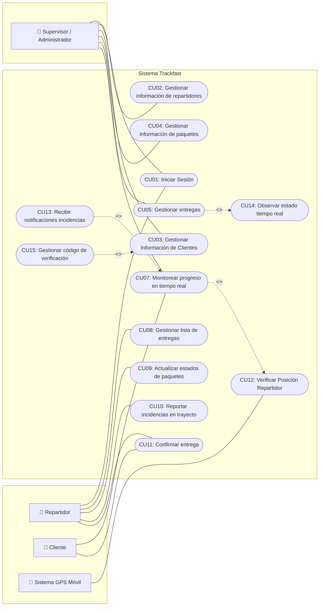

# Modelado del Sistema — Casos de Uso y Diagramas

Este directorio contiene los artefactos de modelado del sistema **Trackfast** correspondientes a la **Tarea 3** y al **Laboratorio: el proceso del equipo**.

---

## 📁 Contenido del Directorio

| Archivo | Tipo | Descripción |
| :--- | :--- | :--- |
| [`Casos_De_Uso_Editable.drawio`](Casos_De_Uso_Editable.drawio) | **Editable (Draw.io / diagrams.net)** | Diagrama general de casos de uso editable en Draw.io / diagrams.net (exportado de Lucidchart). |
| [`casos_de_uso.puml`](casos_de_uso.puml) | **Editable (PlantUML)** | Código fuente editable del Diagrama General de Casos de Uso. |
| [`Casos_De_Uso.pdf`](Casos_De_Uso.pdf) | Documento PDF | Especificación formal completa de los casos de uso, flujos y pruebas. |
| [`Diagrama_Casos_De_Uso_General.pdf`](Diagrama_Casos_De_Uso_General.pdf) | Diagrama PDF | Exportación en alta resolución del diagrama general de casos de uso. |
| [`Diagrama_arquitectura.pdf`](Diagrama_arquitectura.pdf) | Diagrama PDF | Diagrama de arquitectura de microservicios y persistencia híbrida. |

---

## 👥 Actores del Sistema

| Actor | Tipo | Descripción | Objetivos con el sistema |
| :--- | :--- | :--- | :--- |
| **Supervisor / Administrador** | Primario | Coordina pedidos, asigna entregas y monitorea la operación global. | Monitorear repartidores en tiempo real, gestionar pedidos/personal y atender incidencias. |
| **Repartidor** | Primario | Traslada productos desde bodega hacia la ubicación del cliente. | Recibir asignaciones diarias, informar incidencias, actualizar estados y confirmar entrega con QR. |
| **Cliente** | Primario | Destinatario final del producto transportado. | Visualizar trayecto en tiempo real vía web, recibir alertas y validar recepción con código QR. |
| **Sistema GPS del móvil** | Secundario | Servicio integrado en el smartphone del repartidor. | Transmitir periódicamente coordenadas geográficas precisas al backend. |

---

## 🌐 Fronteras del Sistema

| Incluido (Dentro del Sistema) | Excluido (Fuera del Sistema) |
| :--- | :--- |
| Monitoreo de la posición del repartidor en tiempo real | Atención al cliente por chat/llamada |
| Gestión integral de clientes, pedidos y entregas | Contacto directo del cliente con el repartidor |
| Monitoreo de pedidos y desempeño de repartidores | Sistema de calificación y reseñas de repartidores |
| Mecanismo de validación y confirmación de entrega por QR | Cálculo de tiempos estimados de llegada (ETA) |
| Reporte de incidencias y contratiempos en ruta | Sistema de e-commerce o pasarela para ordenar productos |
| Gestión de estados de paquetes (`Pendiente`, `En progreso`, `Completado`) | Selección de repartidores por parte del cliente |

---

## 🧩 Diagrama General de Casos de Uso

A continuación se presenta la representación visual del sistema. Para ver o modificar el archivo fuente editable, consulte [`casos_de_uso.puml`](casos_de_uso.puml).



---

## 🔗 Justificación de Relaciones `<<include>>` y `<<extend>>`

| Relación | Justificación Técnica |
| :--- | :--- |
| **`CU15` «extend» `CU03`** | Al registrar o gestionar los datos del cliente, **únicamente cuando el paquete sale de bodega y va en camino** (condición de extensión), se dispara la generación del código único de verificación. |
| **`CU07` «include» `CU12`** | El monitoreo en vivo requiere de forma obligatoria consultar las coordenadas emitidas por el repartidor para trazar la ruta y calcular proximidad. |
| **`CU13` «extend» `CU07`** | Durante el monitoreo de la ruta, **solo si el repartidor reporta un percance o contratiempo** (condición de extensión), se despliegan las alertas de retraso o incidencia. |
| **`CU05` «include» `CU14`** | La gestión de entregas incluye de manera imperativa observar las transiciones de estado en tiempo real (`Pendiente` → `En progreso` → `Completada`). |

---

## 📊 Matriz de Trazabilidad (Requisitos vs Historias vs Casos de Uso)

| Requisito Funcional | Historia de Usuario | Caso de Uso | Observación |
| :--- | :--- | :--- | :--- |
| **RF1** Gestión usuario Cliente | HU1 | `CU03` | Registro de clientes y código de recepción único. |
| **RF2** Gestionar usuario repartidores | HU2 | `CU02` | Registro y administración de personal de reparto. |
| **RF3** Gestión usuario Administrador | HU3 | `CU07` | Consulta de datos y asignaciones activas. |
| **RF4** Gestionar envíos (CRUD y asignación) | HU4 | `CU04`, `CU05`, `CU08` | Asociación de paquetes a las rutas de los repartidores. |
| **RF5** Registrar cambio de estado | HU5, HU6 | `CU09`, `CU10`, `CU13` | Actualización de estado en app móvil y reporte de retrasos. |
| **RF6** Registrar entrega de paquete | HU7 | `CU11`, `CU15` | Validación formal de entrega mediante escaneo QR y código. |
| **RF7** Consultar ubicación del paquete | HU8 | `CU07`, `CU12`, `CU14` | Consulta GPS y renderizado de trayectoria en mapa interactivo. |
| **RF8** Reporte de paquetes e incidencias | HU9, HU10 | `CU04`, `CU05`, `CU08` | Auditoría de rutas, entregas y tiempos. |
| **RF9** Autenticación de usuarios | HU11, HU12 | `CU01` | Control de acceso por rol (JWT en API Gateway). |

---

## 🛠️ Cómo Editar y Visualizar el Diagrama Editable

### Opción 1: Diagrams.net / Draw.io (Archivo [`Casos_De_Uso_Editable.drawio`](Casos_De_Uso_Editable.drawio))
1. **En Navegador (Recomendado, gratuito):**
   * Ingresar a [app.diagrams.net](https://app.diagrams.net/).
   * Seleccionar **Abrir diagrama existente (Open Existing Diagram)** y elegir `Casos_De_Uso_Editable.drawio`.
   * Realizar los cambios deseados y guardar nuevamente el archivo.
2. **En Visual Studio Code:**
   * Instalar la extensión **Draw.io Integration** (`hediet.vscode-drawio`).
   * Al hacer clic sobre `Casos_De_Uso_Editable.drawio` se abrirá el editor gráfico directamente dentro de VS Code.

### Opción 2: PlantUML (Archivo [`casos_de_uso.puml`](casos_de_uso.puml))
1. **En Visual Studio Code:**
   * Instalar la extensión **PlantUML** (`jebbs.plantuml`).
   * Abrir `casos_de_uso.puml` y presionar `Alt + D` para previsualizarlo en tiempo real.
2. **En Navegador (sin instalar nada):**
   * Copiar el contenido de `casos_de_uso.puml` y pegarlo en [PlantText.com](https://www.planttext.com/) o [PlantUML Online Server](http://www.plantuml.com/plantuml/uml/).
3. **Generar imagen PNG/SVG por comando:**
   ```bash
   plantuml casos_de_uso.puml
   ```

### Opción 3: Exportar nuevas versiones desde Lucidchart
Si se realizan cambios en **Lucidchart**, seguir este procedimiento para actualizar el repositorio:
1. En Lucidchart, ir a **Archivo (File)** → **Descargar como (Download as)**.
2. Seleccionar el formato **Visio (.vsdx)**.
3. Abrir [app.diagrams.net](https://app.diagrams.net), cargar el `.vsdx` y guardarlo como `Casos_De_Uso_Editable.drawio` en esta carpeta.
