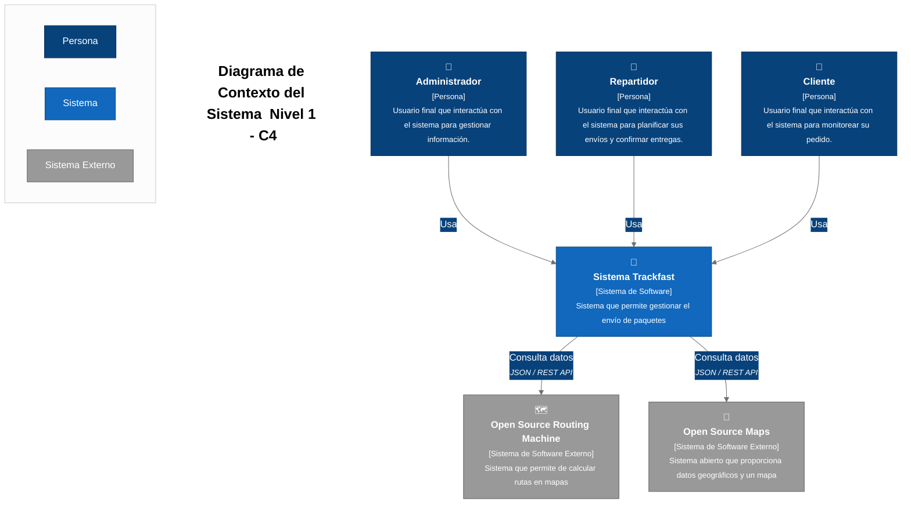
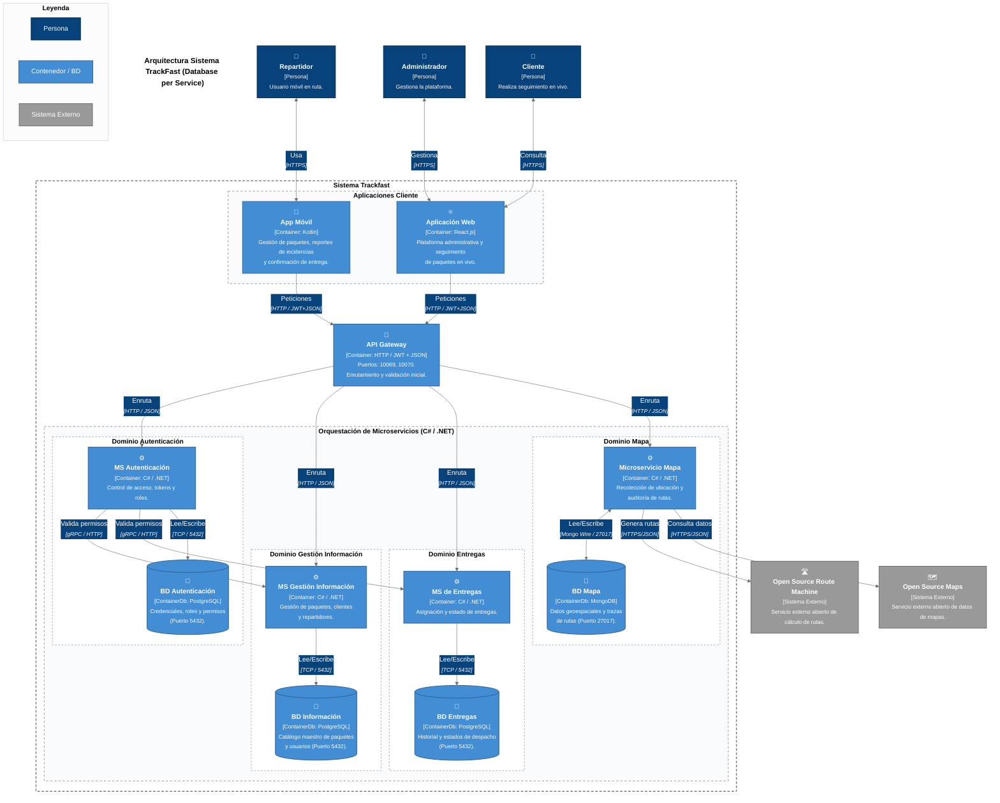

### Descripción de la propuesta
Como resultado de una investigación y comparación entre las siguientes arquitecturas:
* Monolito
* Microservicios
* Serverless
* Event-Driven

Se escogió la arquitectura de microservicios para el proyecto *Trackfast*, debido a las ventajas que ofrece y a que se adapta correctamente al contexto y necesidades del proyecto.

### Justificación de la propuesta

#### 1. Características y ventajas de la arquitectura de microservicios

* Al separar en microservicios,  se pueden separar correctamente módulos con comportamientos y características distintas (protocolos de comunicación, consumo de recursos externos, tecnologías) manteniendo la funcionalidad unificada del sistema.

* La tolerancia a fallos de uno de los microservicios, implica que en caso de que una parte de la aplicación falle, otros módulos permanecen disponibles.

* Los microservicios permiten controlar el rendimiento de cada módulo por separado en el servidor, esto nos permitirá aumentar los recursos independientemente para cada uno en caso de necesitarlo.

* La flexibilidad tecnológica implica que se pueden usar diferentes lenguajes y tecnologías para cada servicio si se determina que es necesario, lo que minimiza la complejidad de trabajar en cada servicio.

* En caso de refactorización o cambios por mantenimiento, es más fácil  realizar cambios tanto en la capa de presentación como en la capa de servicios y control

#### 2. Criterios de Brown
Una de las razones para escoger la arquitectura es que cumple con los criterios establecidos por Brown para elegir arquitectura. Estos criterios indican que la arquitectura escogida debe ser compatible con:

| **Criterio del proyecto** | **Cumplimiento de la arquitectura escogida** |
| - | - |
|**1.-Requisitos Funcionales**|Dentro de la aplicación, existen funcionalidades relacionadas entre sí, pero con una lógica y comportamientos distintos. La arquitectura de microservicios permite tener una correcta separación de estas funciones. En el caso de las funciones de gestión de información y monitoreo especialmente, aunque usen la misma información, ambas funcionalidades manejan comportamientos y flujos muy distintos.|
|**2.-Requisitos No Funcionales**|Entre los requerimientos de calidad definidos, se hace énfasis claro en la disponibilidad y eficiencia del sistema, así como la tolerancia a fallos, ya que se busca minimizar interrupciones en el servicio a los clientes. Los microservicios permiten cumplir con esas características adecuadamente y con menor complejidad de implementación.|
|**3.-Restricciones del proyecto**|Si bien el equipo de desarrollo es pequeño, y los plazos son cortos, estas limitaciones se pueden superar mediante el uso de herramientas de inteligencia artificial, especialmente la parte de codificación que es la más extensa al desarrollar. Paradigmas como SDD *(Spec-Driven-Development)* mediante el uso de herramientas como `Github Spec-Kit` facilitan un desarrollo fluido, minimizando errores y permitiendo enfocarse en aspectos operativos del sistema como el despliegue.|
|**4.-Principios de desarrollo**|El equipo tiene experiencia previa trabajando con microservicios, y manejan correctamente principios y patrones de diseño que pueden contribuir a acelerar el proceso de desarrollo.|

### Razones de descarte de otras arquitecturas

| **Arquitectura** | **Motivo de Descarte** |
| - | - |
|**Monolítica**| Aunque es el enfoque recomendado para aplicaciones de pequeña y mediana escala y ofrece mayor simplicidad en desarrollo, el combinar varios protocolos y tecnologías complica el desarrollo a largo plazo. Además, el proyecto es altamente susceptible a cambios, por lo que trabajar en un monolito implicaría cambios en cadena para implementar una modificación ligera. Por último, el tener todo el sistema en un único punto de falla implica que si un módulo falla, todo el sistema cae y el servicio se interrumpe. |
|**Serverless**| Esta arquitectura se descartó rápidamente debido a la cantidad excesiva de recursos en la nube que demanda, los cuales no pueden ser costeados debido al alto costo. Además, la dependencia excesiva de proveedores implica que un fallo de su parte compromete todo el sistema.|
|**Orientada a eventos**| Esta arquitectura se descartó ya que se manejan datos y reglas de negocio estructuradas y complejas. Si bien el enfoque de mensajería es válido y se puede usar en la arquitectura escogida para enlazar ciertos microservicios, la implementación de seguridad en cada canal es sumamente compleja, y el contexto del sistema no se acomoda a las soluciones que ofrece esta arquitectura.|

### Descripción de resultados de la propuesta

La arquitectura propuesta se documenta en diagramas que siguen el estándar **C4** propuesto por Simon Brown, quien maneja 4 niveles de abstracción para la arquitectura de un sistema:
|**Nivel**|**Diagrama**|**Contenido**|
| - | - |-|
|**C1** |**Diagrama de sistema o contexto**|Muestra el sistema que ofrece una funcionalidad al usuario junto con otros sistemas externos de los que depende.|
|**C2**|**Diagrama de contenedores**|Muestra unidades funcionales desplegables o módulos, que pueden contener código o datos, junto con sus responsabilidades y tecnologías usadas.|
|**C3**|**Diagrama de componentes**|Muestra componentes que manejan funcionalidades específicas a nivel de código, dentro de un contenedor.|
|**C4**|**Diagrama de código**|Similar al diagrama de clases, muestra los objetos de código presentes dentro de un componente.|

#### Diagrama de Contexto (C1)

#### Diagrama de Contenedores (C2)
